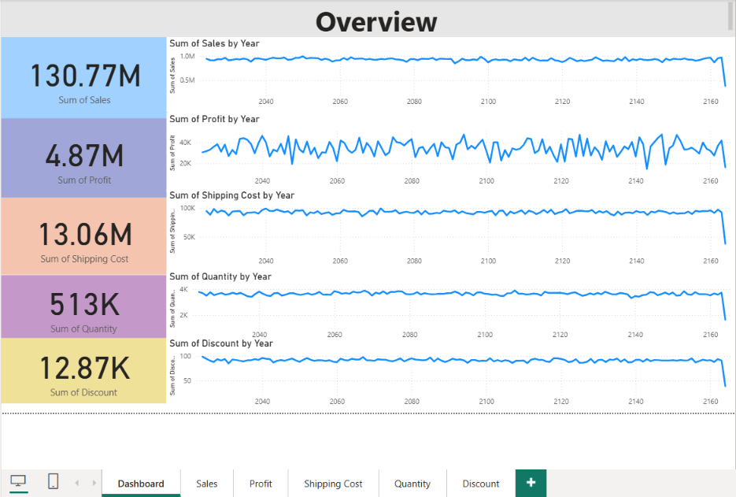

# Sales Performance Dashboard | Power BI

A multi-page Power BI report exploring sales, profit, shipping costs, quantities and discounts across markets, countries and product sub-categories.

## Preview

## Report pages

| Page | Analysis |
| --- | --- |
| Dashboard | Headline KPIs and trends |
| Sales | Sales across geographical and product dimensions |
| Profit | Profit distribution and performance |
| Shipping Cost | Shipping spend across locations and shipping modes |
| Quantity | Units sold across regions and product groups |
| Discount | Discount patterns across countries, markets and sub-categories |

## Snapshot observations

The committed overview screenshot displays **130.77M sales**, **4.87M profit**, **13.06M shipping cost** and **513K units**. These are the report's displayed aggregates in that saved view; they have not been independently reconciled with a source dataset. Currency is not specified in the screenshot.

The overview's year axis extends into future years, so date parsing and the date model need checking before interpreting year-over-year trends. Summed discount values also need business context; they should not be presented as an average discount rate.

## Explore the report

1. Download [Sales-Performance-Dashboard.pbix](Sales-Performance-Dashboard.pbix).
2. Open the file in Power BI Desktop.
3. Use the page tabs and slicers to explore the report.
4. If refreshing data, review **Data source settings** and update any local file paths first.

## Screenshots

- [Sales performance](Screenshots/Sales%20Perfomance.png)
- [Profit performance](Screenshots/Profit%20Perfomance.png)
- [Shipping cost](Screenshots/Shipping%20Cost.png)
- [Quantity](Screenshots/Quantity.png)
- [Discount](Screenshots/Dashboard.png)

## Skills demonstrated

Power BI Desktop · KPI reporting · Interactive filtering · Data visualisation · Business intelligence

## Dataset and limitations

The repository contains the PBIX report and screenshots. A separate source dataset and its original download URL are not documented. The report requires validation in Power BI Desktop; this documentation update does not certify its data model or calculations.

## Next steps

- Validate date types and the calendar relationship.
- Document the dataset source, reporting period and currency.
- Define sales, profit margin, shipping-cost ratio and discount measures explicitly.
- Refresh screenshots after checking the report against source totals.
